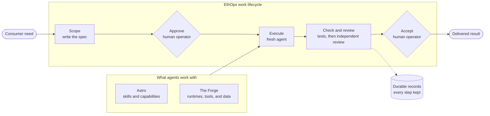
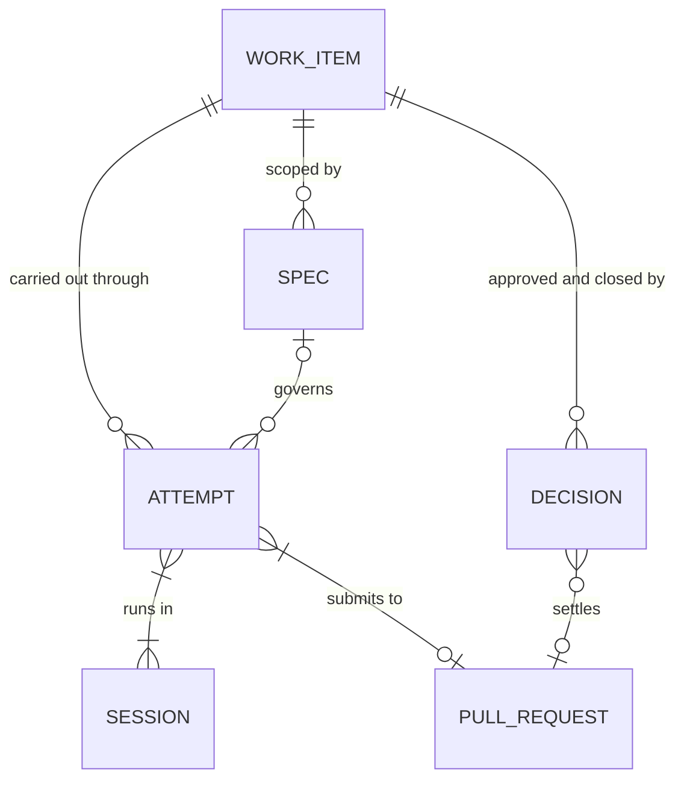
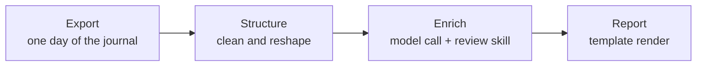

<!--
---
title: "EthOps"
description: "An operating model for getting real work done with AI agents, organized like an IT service team"
author: "VintageDon (https://github.com/vintagedon/)"
date: "2026-10-23"
version: "0.5"
status: "Draft"
tags:
  - type: project-root
  - domain: [autonomous-ops, itil]
related_documents:
  - "[Project Charter](CHARTER.md)"
  - "[Proxmox Astronomy Lab](https://github.com/radioastronomyio/proxmox-astronomy-lab)"
  - "[Steam Dataset 2025](https://github.com/vintagedon/steam-dataset-2025)"
  - "[Analysis-Ready Datasets](https://github.com/vintagedon/analysis-ready-datasets)"
---
-->

  
  <h1>EthOps</h1>
  
<strong>Real work with AI agents, organized like an IT service team.</strong>

  
Deliver useful work. Learn from it. Leave the next person or agent better equipped.

  

    
    
    
    
    
    
  

  

    <a href="#-about">About</a> ·
    <a href="#-architecture">Architecture</a> ·
    <a href="#-how-it-works">How It Works</a> ·
    <a href="#-status">Status</a> ·
    <a href="CHARTER.md">Charter</a>
  

---

## 💡 About

**EthOps** is an operating model for getting real work done with AI agents, organized the way an IT service team is. It borrows the structure of IT service management (requests, changes, review, and a record of everything) and applies it to work shared between a human operator and several AI models.

The lab behind it runs astronomy research, data engineering, software, and game projects. Each one is a **consumer**: it needs compute, data, tools, or finished work. Agents are consumers too. They need clear assignments, the right context, and tools that work.

Work moves in **bounded units**. A need becomes a written spec, a fresh agent carries it out, checks run, and the result arrives as a pull request. The AI models take turns building and reviewing, and none reviews its own work. The human operator approves the work before it starts and accepts the result when it's done.

Every job leaves something behind: a sharper skill, a tested script, a documented decision. That is **scaffolding through real work**. The next job starts further along because the last one was done properly.

Every tool is a **module**. The ticketing system, the scheduler, the model provider, and the agent harness can each be swapped without changing how work is approved or recorded. Most coordination is manual today, and that works. Automation gets added where real work shows it pays off.

EthOps grew out of the [Proxmox Astronomy Lab](https://github.com/radioastronomyio/proxmox-astronomy-lab), a homelab that started in 2023 with a few mini PCs and an old NAS. Its clearest result so far is [Steam Dataset 2025](https://github.com/vintagedon/steam-dataset-2025), a public research dataset whose lessons became a reusable method for preparing data.

---

## 🏛 Architecture

- **Consumers** bring needs: a research project needs prepared data, a service needs a fix, an agent needs a better skill.
- **The lifecycle** turns a need into an approved, checked, and accepted result. The human operator holds both decision points.
- **The Forge** is the working environment: the machines, runtimes, data services, and tools every project uses.
- **Astro** is the capability layer: the skills, scripts, and model-assisted operations agents use to do the work.
- **Durable records** hold the work itself, so a tool can be replaced and a fresh agent can pick up where the last one stopped.

---

## 🔎 How It Works

<strong>Scaffolding through real work</strong>

### Scaffolding Through Real Work

Most improvement in the lab comes from doing useful work and paying attention to what it shows. A hard assignment exposes a missing skill. A failed check exposes a bad assumption in a spec. Preparation that keeps repeating becomes a tested script or a prepared dataset. A step that costs more than it saves gets cut.

The support that gets kept can be small: a better instruction, a reusable check, a decision written down. There is no quota for new frameworks. Support earns its place when later work is easier, safer, or cheaper. Our working name for this is **praxatic scaffolding**.

<strong>Work lives in records, not conversations</strong>

### Work Records

A conversation is a good place to think and a bad place to keep track of work. EthOps keeps each piece of work in linked records, and each record keeps its own identity.

One work item can take several attempts. One pull request can collect attempts from several sessions. A small fix may need no spec at all. Because the links carry the history, a fresh agent can resume from the records alone, and losing a tool costs convenience instead of the work.

<strong>First pilot: a daily log digest</strong>

### First Pilot: Daily Log Digest

The first pilot is a once-a-day digest of the lab's system log. It recurs, it's low-risk, and it touches every step from intake to closure.

Code computes the counts, and the model's findings are labeled as the model's. Each stage is a module: cron or Semaphore can trigger it, JSON or XML can carry it, and the model can run locally or through a hosted provider.

No one here has used this inference provider before, so the pilot starts with a probe instead of a finished design. An Ansible playbook sends fixed log samples, raw and lightly cleaned, to three models on DeepInfra and records latency, token usage, and every response. The human operator reads the results and answers six questions:

1. Does the round trip work?
2. Is the latency acceptable for a daily job?
3. Which models give useful answers?
4. Does the review skill need changes?
5. Does the raw log work, or does it need cleaning first?
6. Does simple routing between models work?

Structured output comes next, then the report. Each step is scoped by what the one before it showed.

<strong>Proof so far: Steam to ARD</strong>

### Steam to ARD

[Steam Dataset 2025](https://github.com/vintagedon/steam-dataset-2025) is a large Steam catalog and review dataset with preparation code, documentation, and worked examples. Its [archived release](https://doi.org/10.5281/zenodo.17266923) gives others a citable starting point. It has been downloaded about 9,400 times on Kaggle and 1,400 times on Zenodo, and TU Dortmund's [Digital Humanities meeting](https://kuwi.tu-dortmund.de/details/event-digitale-geisteswissenschaften-67201/) on November 10, 2026 uses it as the basis for combining text and data mining with game studies.

Building it changed what came next. Steam was a proto-ARD: its lessons became the [Analysis-Ready Datasets](https://github.com/vintagedon/analysis-ready-datasets) method. ARD starts from what researchers keep needing and prepares it once (derived measurements, embeddings, graph relationships) so later users don't repeat the work.

That is the pattern EthOps is built around. Useful work produces a result, the experience produces reusable support, and the next consumer starts further along.

<strong>For ITSM practitioners: the mapping</strong>

### ITIL in EthOps

If you run a service desk, most of this will look familiar.

| ITIL practice | In EthOps |
|---------------|-----------|
| Service request and incident | A work item, opened by a consumer need or an alert |
| Change enablement | A spec the human operator approves before anything runs |
| Change Advisory Board | The human operator and the AI models review together; only the human approves |
| Separation of duties | The model that builds a change never reviews it |
| Problem management | Repeated friction or failed checks become their own work items |
| Knowledge management | Skills, runbooks, and decisions kept from past work |
| Continual improvement | Scaffolding: every job leaves the next one better equipped |
| CMDB and service records | Durable work records today; an ITSM platform such as iTop is planned |

The difference is who does the work. Most of the hands are AI agents, so assignments have to be explicit, context has to be selected, and approval has to come from outside the model.

<strong>The lab as a skill nexus</strong>

### The Lab as a Skill Nexus

The lab is also a **skill nexus**: a place where real projects build connected skills. Every task has a skill blast radius. Standing up PostgreSQL touches scoping, architecture, security, VM sizing, schema design, testing, and operations. Carrying that work from idea to running service builds judgment about how those choices affect each other.

The scaffolding works in two places at once. Experience builds judgment in the person. Documented decisions, tested tools, and reusable methods build support in the environment, and fresh agents can use that support too. Offloading the routine leaves more attention for the unfamiliar.

---

## 📊 Status

| Area | Status |
|------|--------|
| Steam Dataset 2025 | Published and in use |
| Analysis-Ready Datasets method | Developing from real projects |
| Spec-to-pull-request engineering | In regular use |
| Daily log digest pilot | Step 1 specified |
| Astro | Being redesigned |
| ITSM platform integration (iTop) | Planned |
| Charter | Draft |

The [charter](CHARTER.md) sets out the commitments in full: authority, the work lifecycle, records, and what gets published. Earlier designs are kept in the [original README](https://github.com/vintagedon/ethops/blob/59da2c52f25ad53280ab4ccb070c29003ea910ec/README.md) and the [September charter draft](https://github.com/vintagedon/ethops/blob/e3331102add1ffa0ebb7983a643f9ae60d85e8c8/CHARTER.md).

---

## 📄 License

- **Code**: [GNU General Public License v3.0](LICENSE)
- **Documentation and content**: [CC BY 4.0](LICENSE-DATA)

---

Part of the [donaldfountain.ai](https://donaldfountain.ai) network.

