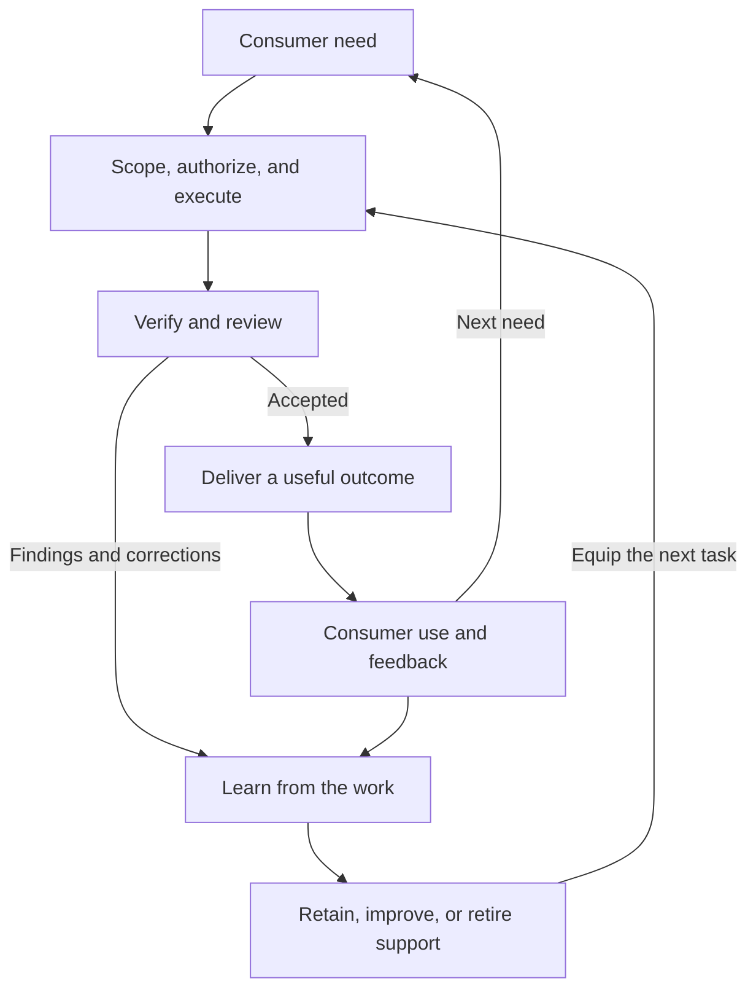
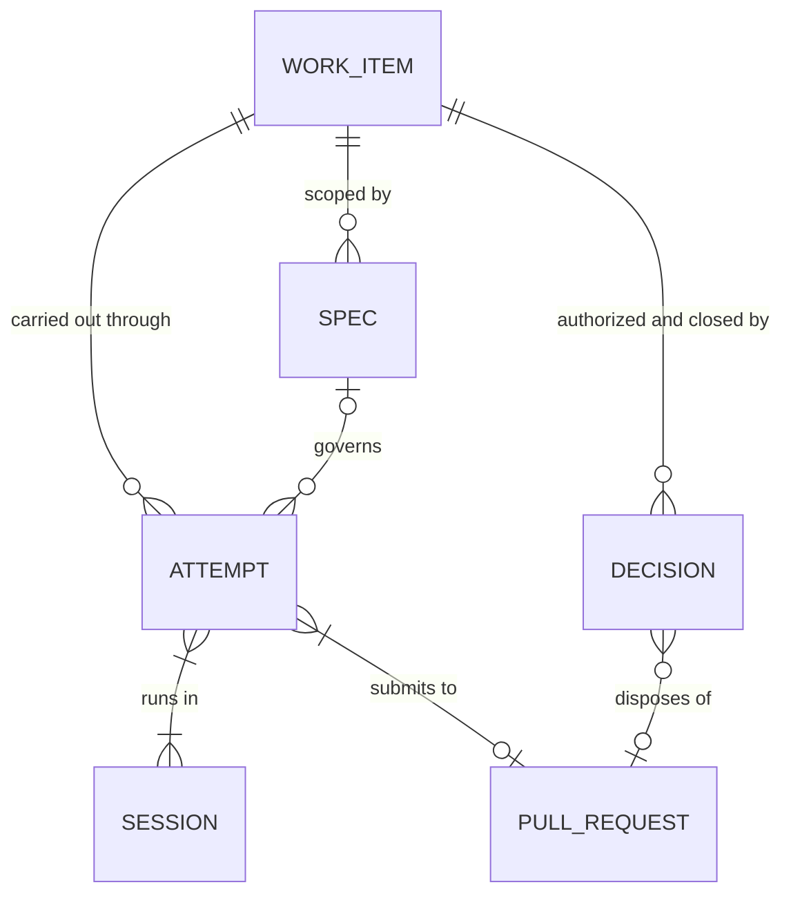

<!--
---
title: "EthOps"
description: "A service operating model for human-AI collaboration, consumer value, and scaffolding through real work"
author: "VintageDon (https://github.com/vintagedon/)"
date: "2026-10-23"
version: "0.4"
status: "Draft"
tags:
  - type: project-root
  - domain: [autonomous-ops, itil]
related_documents:
  - "[Project Charter](CHARTER.md)"
  - "[Proxmox Astronomy Lab](https://github.com/radioastronomyio/proxmox-astronomy-lab)"
  - "[Steam Dataset 2025](https://github.com/vintagedon/steam-dataset-2025)"
  - "[Analysis-Ready Datasets](https://github.com/vintagedon/analysis-ready-datasets)"
---
-->

<div align="center">
  
  <h1>EthOps</h1>
  <p><strong>A service operating model for human-AI collaboration.</strong></p>
  <p>Deliver useful work. Learn from it. Leave the next person or agent better equipped.</p>

  <p>
    
    
    
    <a href="LICENSE"></a>
    <a href="LICENSE-DATA"></a>
  </p>

  <p>
    <a href="#-why-this-exists">Why</a> ·
    <a href="#-value-to-consumers">Value</a> ·
    <a href="#-the-system-in-action-steam-to-ard">Steam to ARD</a> ·
    <a href="#-scaffolding-through-real-work">Scaffolding</a> ·
    <a href="#-first-pilot-daily-log-digest">Pilot</a> ·
    <a href="#-architecture">Architecture</a> ·
    <a href="#-project-status">Status</a> ·
    <a href="CHARTER.md">Charter</a>
  </p>
</div>

---

## ❓ Why This Exists

AI work tends to live in conversations. A conversation is a good place to think and a poor place to keep what was asked, who approved it, what ran, and whether the result was accepted. When the session ends or the tool changes, that history goes with it.

EthOps treats human-AI collaboration as service delivery. A consumer brings a need, and the work is scoped, authorized, executed, checked, reviewed, and accepted on durable records that a fresh person or agent can pick up. What the work teaches is kept and reused, so the next piece starts further along. **EthOps defines how we work; Astro supplies the capabilities we work with.**

If you come from IT service management, the parts will be familiar: defined roles, shared work records, bounded authority, change review, and continual improvement. EthOps applies them to teams in which some participants are AI. It runs on manual coordination today. A service desk such as iTop is the intended home for richer records, and the model does not depend on it.

---

## 🧭 Overview

This work grew out of the [Proxmox Astronomy Lab](https://github.com/radioastronomyio/proxmox-astronomy-lab), whose retained repository history begins in November 2023. The environment started with mini PCs and an old NAS, expanded, and changed as its workloads changed. Research, data engineering, software development, and creative projects supplied the reasons to build it.

The same perspective applies to AI. Compute, subscriptions, tools, and human attention are resources that consumers use to accomplish something. A research result, a reliable service, a game enjoyed by its creator, or a dataset useful to someone else can each justify the work. Value includes enjoyment, learning, and creative progress alongside measurable technical or financial outcomes.

The engineering process has demonstrated a useful foundation: a fresh agent can receive a scoped specification and selected context, execute a coding task, run checks, commit the result, submit a pull request, and take it through triad review. Corrections and amendments are part of that process. This gives us something concrete to build on: a way to carry intent through execution and review, then use what happened to improve the next assignment.

EthOps organizes that practice as service delivery. ITIL provides a framework for requests, incidents, problems, changes, knowledge, and continual improvement. The triad of **Don, Claude, and GPT** acts as the Change Advisory Board (CAB). Claude and GPT rotate through builder and reviewer seats; Don holds approval, priority, and merge authority.

---

## 💡 Value to Consumers

The environment serves several consumers, often in overlapping roles: Don, the astronomy, engineering, and hobby projects that run on it, the agents and AI peers doing the work, and outside researchers and builders who reuse what it publishes. An agent consumes knowledge and execution services while producing a result for another consumer. The astronomy workload consumes infrastructure just as a game project does.

Those relationships make shared-resource decisions concrete: what outcome is being supported, for whom, at what cost, and with what effect on everyone else? Successful execution is one input to that judgment; whether the work was worth doing is another. The [charter](CHARTER.md#4-value-and-consumers) sets out what each consumer should get from the service.

---

## 🎮 The System in Action: Steam to ARD

[Steam Dataset 2025](https://github.com/vintagedon/steam-dataset-2025) is an early example of this practice. The project assembled a substantial Steam catalog and review dataset, with preparation code, documentation, and analytical examples. Its [archived release](https://doi.org/10.5281/zenodo.17266923) gives others a citable starting point for their own work.

The result continued to attract use after the initial project. Shared dashboard snapshots show about **9.4K Kaggle downloads** and **1.4K Zenodo downloads**. These are platform download counts, not distinct people.

There is also a specific downstream use. TU Dortmund's [Digital Humanities event announcement](https://kuwi.tu-dortmund.de/details/event-digitale-geisteswissenschaften-67201/) names Steam Dataset 2025 as the basis for its **November 10, 2026** meeting, combining exploratory text and data mining with game studies and interdisciplinary research questions. That is evidence of selection for an upcoming educational event; its outcomes remain to be observed.

Steam also changed the work that followed. It was a **proto-ARD**: experience from the project helped form the [Analysis-Ready Datasets framework](https://github.com/vintagedon/analysis-ready-datasets) that continues to shape this work. The method begins with what researchers repeatedly need, then prepares reusable analytical capabilities. Depending on the domain, those can include derived scalar measurements, embeddings, or graph relationships. Expensive preparation performed once can spare later consumers from repeating it.

The value therefore carries forward in several forms. People can use the Steam dataset. Subsequent projects can use the lessons learned while building it. Other dataset builders can use the ARD methodology to prepare resources for their own communities. The framework is still developing, and external adoption of the methodology is a separate question from downloads of the Steam release.

That is the mechanism EthOps seeks to support: worthwhile work produces a result, experience produces reusable support, and that support helps the next consumer start further along. Steam predates the integrated EthOps system envisioned here. It is evidence of the practice from which the operating model is being formed.

---

## 🔁 Scaffolding Through Real Work

**Praxatic scaffolding** is our working term for building better conditions for future work by doing and examining useful work now.



*Proposed value cycle: delivery serves the consumer; findings and use improve the conditions for later work.*

A difficult assignment might reveal a missing skill. A failed check might expose an unsafe assumption in a spec. Repeated preparation might justify a vetted script or an analysis-ready dataset. A procedure that repeatedly adds overhead may need to be simplified or retired.

The retained support can be small: a better instruction, a reproducible check, a documented decision, or a reliable handoff. There is no quota for creating new frameworks. Its value appears when later work is easier to understand, safer to execute, less costly to repeat, or useful to more people.

---

## 🧪 First Pilot: Daily Log Digest

The candidate first pilot is a once-a-day digest of the environment's system journal. Its shape is simple: export the log, shape it into consistent structured data, enrich it with a model call and a named review skill, and render a report. Code supplies the counts, and the model's reasoning is labeled as its own.

Each seam is replaceable. A cron job or a scheduler such as Semaphore can trigger it, JSON or XML can carry it, and the model can be local or hosted. What matters is that the data stays legible and consistent and that the model's contribution is clearly marked.

The pilot is built one step at a time, because no one on the team has used this inference provider before. The first step is a probe: an Ansible playbook sends fixed log segments, raw and lightly cleaned, to three models on DeepInfra and records latency, token usage, and the responses. Don reads that evidence and answers six questions. Does the round trip work? Is latency acceptable? Which responses are useful? Does the skill need changes? Does the log need transforming? Does simple model routing work? Structured output and the report follow as separate steps, each scoped by what the previous one showed. At this stage a weak answer or a failed call is still useful evidence.

---

## 🏗 Architecture

The architecture separates responsibilities so that tools can improve or be replaced without losing the work's meaning or authority.

| Part | Working definition |
|------|--------------------|
| EthOps | The operating model: consumer relationships, service delivery, the work lifecycle, authority, review, and learning |
| Astro | The capability layer the work draws on: explicit operations, evidence collection, validation, and model-assisted analysis. Its design is being restated, so this repository describes its role rather than its implementation |
| The Forge | The working environment every project uses: runtimes, executors, data services, coordination tools, and durable records. The cluster supports it, projects consume it, and EthOps manages it |
| Consumer projects | Their own goals, domain methods, artifacts, and acceptance criteria |

Work survives in linked records rather than in any one session or tool:



*Proposed record relationships. Each record keeps its own identity, and the links carry the history. A small authorized correction may need no spec, one pull request can gather several attempts across sessions, and one work item can collect several decisions.*

Agents receive context selected for the assignment, mechanical checks run before model review, and collected facts stay distinguishable from model interpretation. iTop is the intended service-management integration, and the triad must be able to resume from preserved records if any coordination tool disappears. The [charter](CHARTER.md) holds these commitments: authority in §6, the work lifecycle in §7, and durable state in §8.

---

## 📊 Project Status

This revision separates demonstrated practice from capabilities still being developed or proposed.

| Area | Status | Evidence or next step |
|------|--------|-----------------------|
| Steam data product | Published; continuing interest visible | Release, download snapshots, and announced TU Dortmund use described above |
| ARD methodology | Developing from real projects | Public framework captures reusable methods emerging from Steam and subsequent work |
| Spec-to-review engineering | Demonstrated operating practice | Scoped agent execution, checks, commits, PRs, and human-led review; no general reliability rate claimed |
| EthOps charter and README | Draft; triad review applied | Adoption awaits Don's recorded decision |
| Agent guidance | Aligned with the draft | `AGENTS.md` points agents at the charter; the earlier design is retained as history |
| Daily log digest pilot | Step 1 specified; not yet run | Provider probe first; structured output and the report follow as separate steps |
| Astro capabilities | Being restated | Role defined above; implementation evidence lives with Astro |
| iTop-centered coordination and broader automation | Proposed integration | Validate through real service work before treating the complete workflow as available |

The earlier [README](https://github.com/vintagedon/ethops/blob/59da2c52f25ad53280ab4ccb070c29003ea910ec/README.md) and [September charter draft](https://github.com/vintagedon/ethops/blob/e3331102add1ffa0ebb7983a643f9ae60d85e8c8/CHARTER.md) preserve the project's development. Their deployment claims, hardware assumptions, and component choices should be read in that historical context. This revision does not claim an integrated autonomous service organization is already deployed.

---

## 🧠 The Lab as a Skill Nexus

The lab was conceived as a **skill nexus**: a place where useful projects develop connected capabilities. Each task has a "skill blast radius." Standing up PostgreSQL, for example, can involve scoping, architecture, security, VM sizing, schema design, testing, and ongoing operations. Carrying the work from intent through delivery, maintenance, and documentation develops judgment about how those choices affect one another.

This is the cognitive-development thread beneath the practice. Scaffolding is inherent in doing and reviewing the work: experience develops personal judgment, while documented decisions, tested tools, and reusable methods preserve support in the environment. That cognitive offloading leaves more attention for unfamiliar problems and new learning. Fresh agents can use the retained support too. Better scaffolding improves practice, and practice reveals how to improve the scaffolding.

---

## 📁 Repository Structure

```text
ethops/
├── CHARTER.md        # Operating commitments (draft)
├── README.md         # Introduction, evidence, and project status
├── AGENTS.md         # Agent guidance, aligned with the charter draft
├── docs/             # Documentation standards and a historical infrastructure note
├── assets/           # Logo and historical diagrams
├── shared/           # Repository utilities
├── work-logs/        # Retained project history
├── LICENSE           # Code license (GPL-3.0)
└── LICENSE-DATA      # Data and content license (CC-BY-4.0)
```

Private specifications and reference material are excluded from publication through the repository's ignore rules. The public repository explains the model and shares selected results and reusable material. Publishing an implementation detail or operational record requires a separate review of its suitability for release.

---

## 🚀 Getting Started

Read the [charter](CHARTER.md) for the proposed scope, authority model, work lifecycle, and continuity requirements. Explore [Steam Dataset 2025](https://github.com/vintagedon/steam-dataset-2025) and [Analysis-Ready Datasets](https://github.com/vintagedon/analysis-ready-datasets) for the concrete example and the methodology it helped form.

To apply the approach, begin with one real consumer need. Define a bounded result and its acceptance evidence, use the tools already available, and carry it through execution and review. Retain what proves useful. The next investment should follow the friction, unmet need, or opportunity that work reveals.

For this project, the next step is the log digest probe. Its evidence decides the second step.

---

## 📄 License

- **Code**: [GNU General Public License v3.0](LICENSE)
- **Data/Content**: [CC-BY-4.0](LICENSE-DATA)

---

<div align="center">

Part of the [donaldfountain.ai](https://donaldfountain.ai) network.

</div>

---

Last Updated: 2026-10-23 · v0.4: triad review applied (pilot named, Astro and the Forge defined, record diagram, ITSM positioning)
